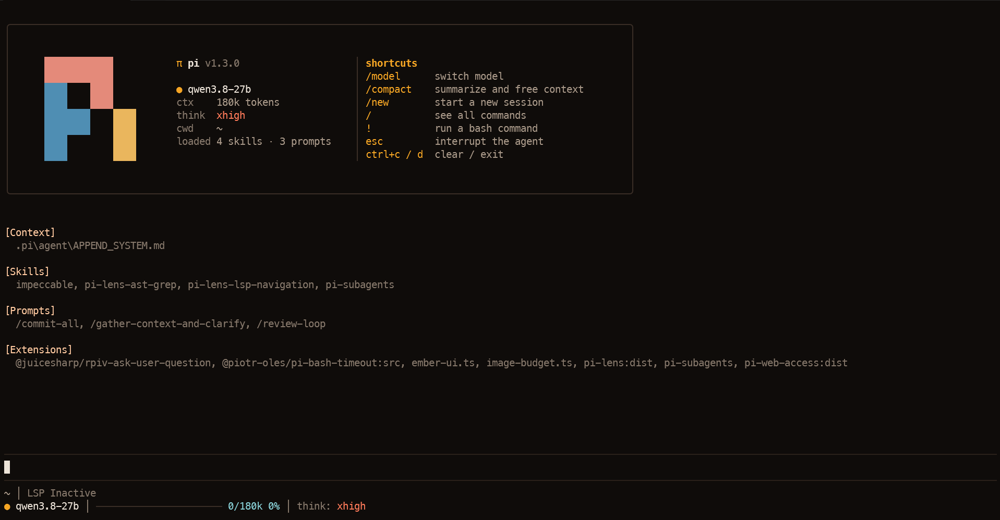
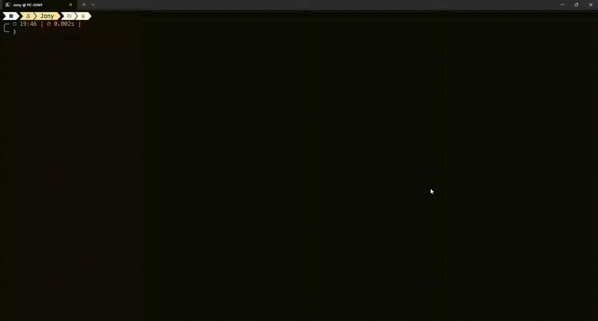

# Ember — Pi Theme & UI Extension

Ember is a warm, dark theme and custom terminal UI for [Pi](https://pi.dev/). It combines a brown-black background and amber accents with a Tetris-inspired startup animation and an information-rich interface.

## Preview



### Startup animation



[Watch the startup animation as an MP4 video](assets/ember-intro.mp4)

## Features

- **Tetris-style startup animation** — the Pi logo assembles from colored pieces, pauses, then floats into the header.
- **Custom welcome header** — Pi version, model, context-window size, thinking level, loaded skills/prompts, and useful shortcuts.
- **Two-line footer** — project path, Git branch, LSP status when available, current model, context usage, thinking level, TTFT, and estimated generation speed.
- **Live activity status** — shows whether Pi is processing, thinking, generating, or running a tool.
- **Animated editor border** — a subtle Tetris-inspired line animation while the agent is working.
- **Context usage bar** — changes from cyan through yellow to coral as the context fills.
- **Responsive layout** — the header adapts to narrower terminals.

## UI-only by design

Ember is designed exclusively to customize the appearance of Pi's terminal interface and display runtime information that Pi already provides.

It does **not** add AI-agent functionality or extra LLM context. In particular, Ember does not register tools, skills, prompt templates, slash commands, model providers, or subagents; it does not inject text into the system prompt or prefill; and it does not make additional model requests. It observes existing Pi session events to update the UI.

The animation and status displays still use a small amount of local CPU/memory and terminal rendering while active, but they do not add model tokens or AI prefill.

## Install

Install directly from GitHub while the package is not yet published on npm:

```bash
pi install git:github.com/JonyPlo/pi-ember-ui
```

After the npm package is published, it can also be installed with:

```bash
pi install npm:pi-ember-ui
```

Restart Pi after installing so the package's extension and theme are loaded.

## Theme behavior

On the first interactive startup after installing Ember, the extension selects the included `ember` theme and Pi saves it as the user's theme preference. A small marker is written to the Pi agent directory so this automatic selection happens only once.

After that first startup, users can freely select another theme in `/settings`. Ember will not force its palette again on later sessions or restarts. The marker is stored outside the package so updating the package does not normally reset the choice.

## Compatibility

Ember was developed and tested with **Pi v1.4.0**. The theme JSON may also work with some older releases, but the complete package depends on Pi's extension and terminal-UI APIs. Pi 0.x versions have not been tested, so compatibility with them is not guaranteed. **Pi v1.4.0 or newer is recommended.**

Ember is designed for Pi's interactive terminal UI (TUI). The startup animation is skipped in terminal environments where the extension detects that the custom intro is unsupported.

## Package contents

- `extensions/ember-ui.ts` — startup animation, header, footer, editor border, activity status, and performance measurements.
- `themes/ember.json` — Ember's color palette and theme tokens.
- `assets/ember-preview.png` — static screenshot used in this README and as the package gallery image.
- `assets/ember-intro.gif` — inline animated preview for GitHub.
- `assets/ember-intro.mp4` — video preview for the Pi package gallery.

## Development

The extension imports these host-provided modules, which are declared as `peerDependencies` rather than bundled:

- `@earendil-works/pi-ai`
- `@earendil-works/pi-coding-agent`
- `@earendil-works/pi-tui`

## License

Ember is licensed under the [MIT License](LICENSE).

Copyright (c) 2026 JonyPlo. The license permits use, modification, and redistribution, including commercially, provided the copyright and license notice are retained. The software is provided “as is”, without warranty.
